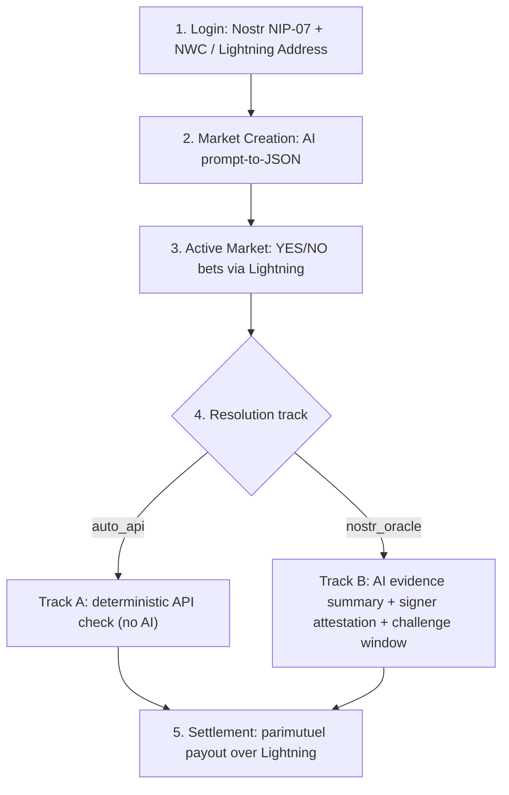
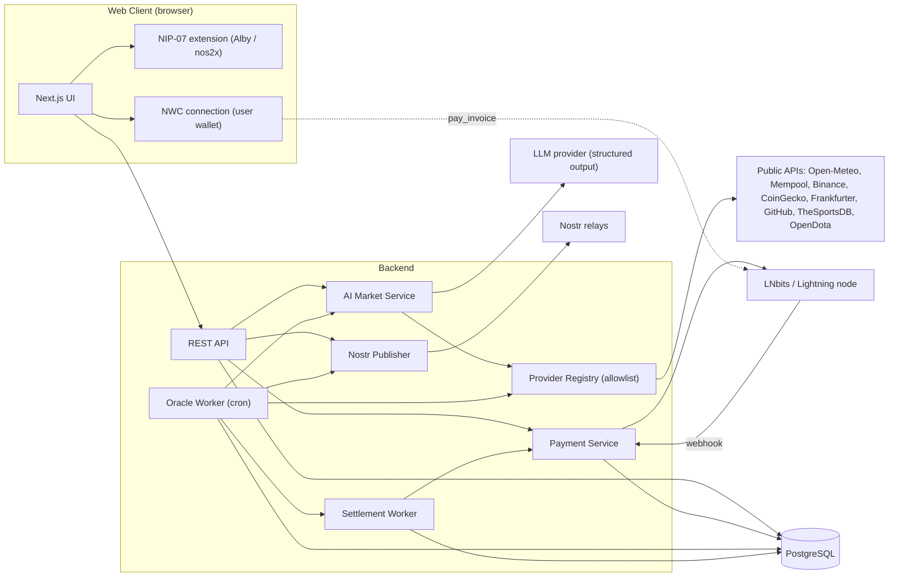
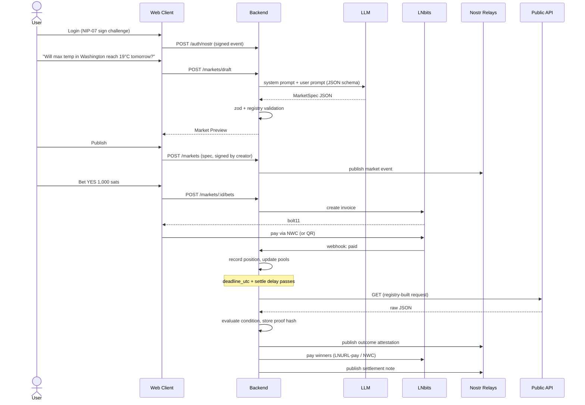

# 02 — System Architecture

## 1. High-Level Flow

## 2. Component Diagram

## 3. Components

| Component | Responsibility |
| --- | --- |
| **Web Client** | Login, market creator, market list/detail, bet slip, proof viewer, signer console |
| **REST API** | Auth (Nostr signed challenge, NIP-98), market CRUD, bets, disputes |
| **AI Market Service** | Prompt → validated `MarketSpec` JSON; optional insight card and evidence summary. See [04](04-ai-market-creator.md) |
| **Provider Registry** | Allowlisted oracle providers: endpoint templates, param schemas, value extractors. The AI can only pick a `provider` id + params, **never a raw URL** |
| **Payment Service** | Creates invoices, verifies settlement webhooks, sends payouts and refunds. See [06](06-lightning-payments.md) |
| **Oracle Worker** | Polls for markets past their deadline, runs Track A fetches, opens Track B attestation windows. See [05](05-oracle-design.md) |
| **Settlement Worker** | Computes the parimutuel split and queues payouts with retries |
| **Nostr Publisher** | Publishes market announcements, outcome attestations, and settlement notes. See [07](07-nostr-integration.md) |
| **PostgreSQL** | Source of truth for markets, bets, oracle proofs, and payouts. See [08](08-data-model.md) |

## 4. Recommended Tech Stack (MVP)

| Layer | Choice | Notes |
| --- | --- | --- |
| Frontend | Next.js (App Router) + TypeScript + Tailwind | Single repo with API routes, fast to build |
| Nostr | `nostr-tools`, `window.nostr` (NIP-07) | Guest keypair generated client-side |
| Wallet | `@getalby/sdk` (NWC), LNbits REST API | LNbits = platform escrow wallet + webhooks |
| AI | Any LLM with JSON-schema structured output (e.g., Gemini) | Temperature 0, schema-enforced |
| DB | PostgreSQL (or SQLite for a pure hackathon demo) + Prisma/Drizzle | |
| Jobs | Node worker with `node-cron` or BullMQ (Redis) | 10–30 s tick for demo markets |
| Validation | `zod` | Shared schemas between AI output, API, and DB |
| Hosting | Vercel (web) + Fly/Railway (worker + DB) | Worker must run all the time |

## 5. End-to-End Sequence

## 6. Deployment Topology

- `web` (stateless): UI + API routes
- `worker` (singleton, or leader-elected): oracle + settlement + payout retries
- `db`: Postgres with daily backups
- Secrets: LNbits admin key, LLM API key, platform Nostr nsec (oracle signer key for house-signed Track A attestations), all kept server-side only.
