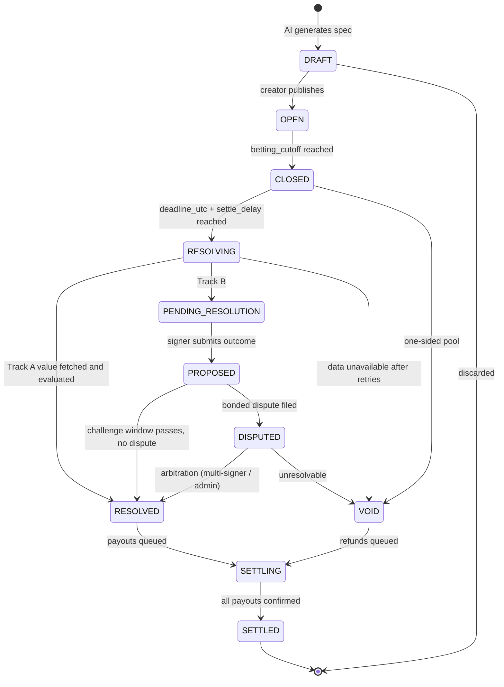

# 03 — Market Lifecycle

## 1. State Machine

## 2. Status Definitions

| Status | Meaning | Bets allowed |
| --- | --- | --- |
| `DRAFT` | AI spec generated, not public | No |
| `OPEN` | Live, published to Nostr | **Yes** |
| `CLOSED` | Past `betting_cutoff`, waiting for event | No |
| `RESOLVING` | Worker fetching data (Track A) or opening attestation (Track B) | No |
| `PENDING_RESOLUTION` | Track B: waiting for signer proposal | No |
| `PROPOSED` | Outcome proposed, challenge window running | No |
| `DISPUTED` | Proposal challenged, needs arbitration | No |
| `RESOLVED` | Final outcome `YES` / `NO` locked | No |
| `VOID` | Invalid / unresolvable / one-sided, so everyone is refunded | No |
| `SETTLING` | Payouts/refunds in progress | No |
| `SETTLED` | Every payout confirmed (or moved to claimable) | No |

## 3. Critical Timestamps

| Field | Rule |
| --- | --- |
| `created_at` | When published |
| `betting_cutoff` | **Must be before the outcome can be known.** For an event-based market, before the event starts. For a weather/daily value, before the start of the measured day (local). For a price at time T, at least *N* minutes before T (demo: 1 min) |
| `deadline_utc` | The moment the measured value is defined (e.g., end of local day converted to UTC, or exact price timestamp) |
| `settle_delay` | Buffer after deadline so data sources finalize (Open-Meteo daily: ≥ 2 h; Binance kline: 1 min; Frankfurter: after ~16:00 CET publish) |
| `challenge_window` | Track B only: 1 h production, 2 min demo |

> [!IMPORTANT]
> Invariant: `created_at < betting_cutoff ≤ deadline_utc < resolve_after`. The API rejects any spec that breaks this. Letting people bet after the outcome is knowable is the #1 way parimutuel markets get drained.

## 4. Edge Cases

| Case | Handling |
| --- | --- |
| One side has 0 sats at cutoff | `VOID`, full refund (no fee) |
| API down / returns null | Retry with backoff for up to 24 h, then `VOID` |
| Ambiguous outcome in Track B | Signer may propose `INVALID`, leading to `VOID` |
| Event cancelled/postponed | Track B signer proposes `INVALID`. Track A markets resolve only on data |
| Payout fails (no route, invalid address) | Retry 3×, then mark `CLAIMABLE`. User claims via LNURL-withdraw / new invoice |
| Bet paid after cutoff (invoice race) | Invoice expiry ≤ time left until cutoff; late payments are auto-refunded |
| Creator edits after publish | Not allowed. Spec is immutable and its hash is committed in the Nostr event |
