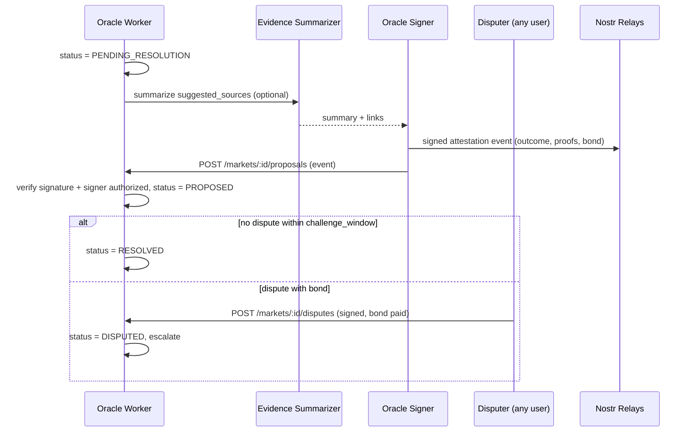

# 05 — Oracle Design (Dual-Track)

## 1. Overview

| | **Track A — `auto_api`** | **Track B — `nostr_oracle`** |
| --- | --- | --- |
| Used for | Values a public API can measure | Real-world events that need human judgment |
| Categories | Crypto, Weather, Finance, Technology (GitHub) | Politics, Culture, Sports, Esports, Economy (+ Tech when not measurable) |
| Decides outcome | Deterministic code | Oracle signer(s) + challenge window |
| AI involvement | **None** | Optional evidence summary for signers |
| Proof | Raw API response + SHA-256 hash, published in a signed Nostr event | Signer's Nostr-signed attestation + proof links |
| Latency | Seconds after `resolve_after_utc` | Challenge window (1 h prod / 2 min demo) |

<a id="routing-matrix"></a>
## 2. Routing Matrix

| Category | Track | Primary MVP data source |
| --- | --- | --- |
| Crypto | `auto_api` | Binance klines, Mempool.space, CoinGecko |
| Weather | `auto_api` | Open-Meteo (no API key) |
| Finance | `auto_api` | Frankfurter (ECB FX rates) |
| Technology | `auto_api` / `nostr_oracle` | GitHub REST API / community |
| Sports | `nostr_oracle` (or API) | TheSportsDB / signer |
| Esports | `nostr_oracle` (or API) | OpenDota / signer |
| Economy | `nostr_oracle` | Central bank / statistics agency releases + signer |
| Politics | `nostr_oracle` | Official sources + multi-signer |
| Culture | `nostr_oracle` | Official announcements / YouTube + signer |

## 3. Track A — Provider Registry

The AI picks a `provider` and `params`. The **registry** turns them into an HTTP request and holds the only allowed hosts.

```ts
interface Provider {
  id: string;                         // "open-meteo"
  baseUrl: string;                    // fixed, allowlisted
  buildRequest(params): { path: string; query: Record<string, string> };
  paramSchema: ZodSchema;             // validates AI params
  allowedValuePaths: RegExp[];        // which JSON paths may be read
  settleDelaySec: number;             // added to deadline
  historical: boolean;                // can query past values? if false, must snapshot at deadline
}
```

| Provider | Request (example) | Value path | Historical? | Settle delay |
| --- | --- | --- | --- | --- |
| **open-meteo** | `GET https://api.open-meteo.com/v1/forecast?latitude&longitude&daily=temperature_2m_max&timezone&start_date&end_date` (use `archive-api.open-meteo.com/v1/archive` for dates older than ~3 months) | `daily.temperature_2m_max[0]` | Yes | 2 h |
| **binance** | `GET https://api.binance.com/api/v3/klines?symbol=BTCUSDT&interval=1m&startTime={deadline_ms}&limit=1` | `[0][4]` (close price) | Yes | 60 s |
| **mempool** | `GET https://mempool.space/api/blocks/tip/height`, `/api/v1/fees/recommended`, `/api/v1/historical-price?currency=USD&timestamp=` | `$`, `fastestFee`, `prices[0].USD` | Partly | 60 s |
| **coingecko** | `GET https://api.coingecko.com/api/v3/simple/price?ids=bitcoin&vs_currencies=usd` | `bitcoin.usd` | No (snapshot) | 0 |
| **frankfurter** | `GET https://api.frankfurter.app/{YYYY-MM-DD}?from=USD&to=EUR` | `rates.EUR` | Yes (ECB working days, ~16:00 CET) | until 17:00 CET |
| **github** | `GET https://api.github.com/repos/{owner}/{repo}` or `/releases/latest` | `stargazers_count`, `tag_name` | No (snapshot) | 0 |
| **thesportsdb** | `GET https://www.thesportsdb.com/api/v1/json/{key}/lookupevent.php?id=` | `events[0].intHomeScore` etc. | Yes | 3 h |
| **opendota** | `GET https://api.opendota.com/api/matches/{match_id}` | `radiant_win` | Yes | 1 h |

> [!NOTE]
> Non-historical providers (CoinGecko, GitHub) must be **snapshotted exactly at `deadline_utc`**. The worker schedules a precise job instead of waiting for the general tick. For price markets, Binance klines are preferred because they can be re-checked at any time.

### Track A algorithm

```text
for market in markets where status = CLOSED and now >= resolve_after_utc and track = auto_api:
    status = RESOLVING
    req   = registry[provider].buildRequest(params)
    resp  = GET req (timeout 10s, max 3 retries, exp backoff)
    if resp fails for > 24h: status = VOID; break
    value = jsonpath(resp.body, value_path)    # must be in allowedValuePaths
    if value is null: retry later / VOID
    outcome = compare(toNumber(value), operator, threshold) ? YES : NO
    proof = { url, fetched_at, http_status, body, sha256(body) }
    save proof; status = RESOLVED; outcome = outcome
    publish Nostr attestation (platform oracle key) with proof hash
    enqueue settlement
```

- Comparisons use decimal math. Floats are rounded to the provider's precision before comparing.
- `==` on floats is only allowed with an explicit tolerance.
- Optional hardening: query 2 providers (e.g., Binance + CoinGecko) and VOID if they disagree by more than X%.

## 4. Track B — Nostr Optimistic Oracle



### Signer policies

| Policy | Who proposes | Finalization | MVP? |
| --- | --- | --- | --- |
| `platform_signer` | Platform's oracle npub | Challenge window | ✅ demo |
| `multisig_2_of_3` | 3 allowlisted signer npubs | 2 matching attestations | Stretch |
| `optimistic_bond` | Anyone who posts a sats bond | Challenge window. A disputer posts an equal bond | Stretch |

### Disputes

1. Disputer pays a bond invoice (≥ proposer bond) and submits a signed dispute with proof links.
2. The market moves to `DISPUTED`. Escalation goes to a 2-of-3 arbitration panel (MVP: platform admins).
3. The loser of the dispute forfeits their bond to the winner, minus a fee.
4. Arbitration may rule `YES`, `NO`, or `INVALID` (leading to VOID/refund).

### Rules for signers

- Signers **cannot bet** on markets they resolve. This is enforced by pubkey + linked Lightning Address.
- Every attestation must include ≥ 1 proof URL and the market spec hash.
- Signer reputation is tracked: resolutions, disputes lost.
