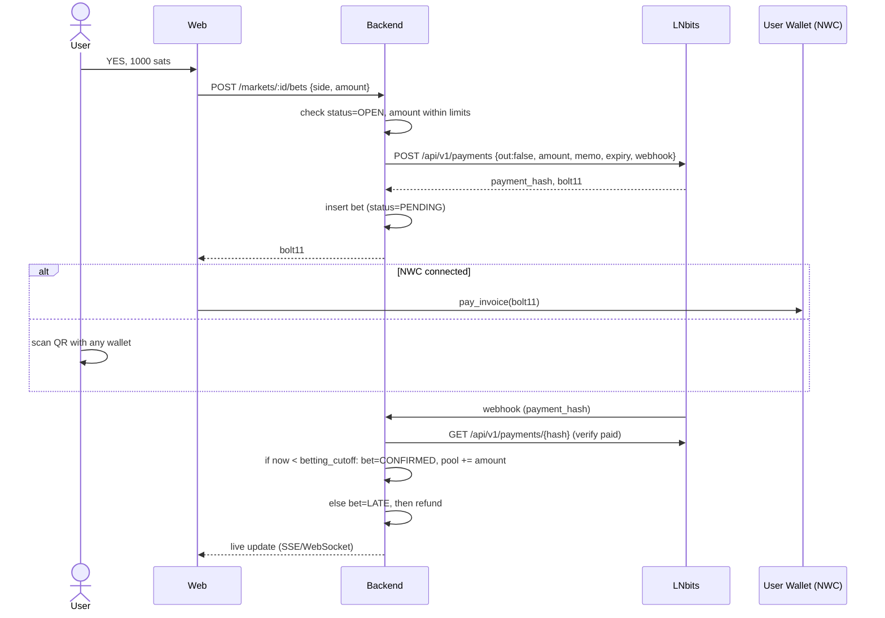

# 06 — Lightning Payments & Parimutuel Settlement

## 1. Wallet Roles

| Wallet | Owner | Used for |
| --- | --- | --- |
| **Platform escrow wallet** | Platform (LNbits wallet) | Receives bets, holds pools, sends payouts/refunds |
| **User wallet via NWC (NIP-47)** | User | 1-click `pay_invoice` for bets. If the user grants `make_invoice`, it can also generate payout invoices |
| **User Lightning Address** | User | Payout destination via LNURL-pay (`name@domain`) |

> [!IMPORTANT]
> **Custody note:** the concept calls this "non-custodial UX", but sats sit in the platform's escrow wallet between the bet and settlement. Users never keep a *balance*, but the platform **is custodial for the lifetime of each market**. The docs and UI should say this honestly. Trust-minimized escrow (DLCs, hold invoices) is future work.

## 2. Bet Flow



Rules:
- **Invoice expiry** = min(10 min, time until `betting_cutoff`).
- **Never trust the webhook body.** Re-check the payment status with LNbits by `payment_hash`.
- Webhooks are handled idempotently: unique `payment_hash`.
- Limits (MVP): min 10 sats, max 100,000 sats per bet, configurable max per market.

## 3. Pool Math (Parimutuel)

- `pool_yes` = Σ confirmed YES stakes, `pool_no` = Σ confirmed NO stakes, `T = pool_yes + pool_no`
- **Implied probability:** `P(YES) = pool_yes / T` (show 50% when T = 0)
- **Potential payout multiplier** (shown in the bet slip): `(T + stake) × (1 − f_eff) / (pool_side + stake)`

### Payout formula from the concept

$$\text{Payout}_i = \frac{s_i}{W}\times(T - \text{Fee})$$

where $s_i$ is the user's stake and $W$ is the winning pool.

> [!WARNING]
> If `Fee = f × T` is charged on the whole pool, winners **lose money** when the losing pool is small. Example: W = 9,900, L = 100, f = 2%. Then T − Fee = 9,800 < W, so winners get back less than they staked.

### Recommended: fee on the losing pool only

$$\text{Payout}_i = s_i + \frac{s_i}{W}\times L\times(1-f)$$

where $L$ is the losing pool and $f$ is the platform fee (e.g., 2%). Winners never get back less than their stake. Platform revenue = $f \times L$.

### Rounding

- Do the math in **millisatoshis** with integer arithmetic. Each payout is `floor(...)`.
- The rounding remainder (dust) goes to the platform fee account and is logged.
- Payouts below a minimum (e.g., 1 sat, or below the wallet's minimum sendable) become `CLAIMABLE` instead of being sent.

### Refunds (VOID)

- One-sided pool, unresolvable, or invalid market: **100% of stake refunded, no fee**.
- Late bets (paid after cutoff): refunded right away.

## 4. Payout Execution

```text
for each winner position (grouped by user):
    amount = computed payout (msat)
    dest   = user.lightning_address  →  LNURL-pay: fetch callback, request invoice for amount
          or user NWC with make_invoice →  request invoice
    verify invoice amount == amount and not expired
    LNbits POST /api/v1/payments {out:true, bolt11}
    on success: payout=SENT, store preimage (proof of payment)
    on failure: retry 3× with backoff (1m, 5m, 30m) → CLAIMABLE
```

- **CLAIMABLE** payouts: the user pastes a bolt11 for the exact amount, or scans an LNURL-withdraw QR.
- Fees for payout routing are paid by the platform. Cap: `fee_limit = max(10 sats, 1%)`.
- The market moves to `SETTLED` when every payout is `SENT` or `CLAIMABLE`.
- A settlement note is published to Nostr with totals and payment hashes (not user identities, unless the user opts in).

## 5. Ledger & Reconciliation

Every sat movement is a row in `ledger_entries` (double-entry: `escrow`, `market:<id>`, `fees`, `user:<pubkey>`). Invariant for each market:

```text
Σ confirmed bets  ==  Σ payouts + Σ refunds + fees + dust
```

A nightly job compares the ledger with the LNbits wallet balance and raises an alert if they differ.

## 6. Configuration

| Key | Default |
| --- | --- |
| `PLATFORM_FEE_BPS` | 200 (2%, on the losing pool) |
| `MIN_BET_SATS` / `MAX_BET_SATS` | 10 / 100000 |
| `INVOICE_EXPIRY_SEC` | 600 |
| `PAYOUT_MAX_RETRIES` | 3 |
| `LNBITS_URL`, `LNBITS_ADMIN_KEY`, `LNBITS_INVOICE_KEY` | secrets |
