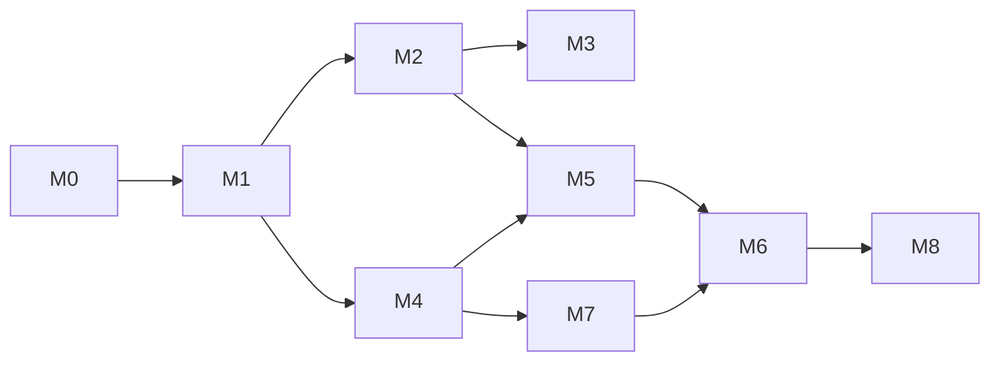

# 11 — MVP Roadmap & Demo Script (Hackathon)

## 1. Priorities (from concept)

1. **Core flow:** Nostr login + AI Market Creator (prompt-to-JSON) + 9-category UI
2. **Payment layer:** sats betting via NWC / LNbits with a parimutuel pool
3. **Live demo Track A:** ≥ 2 auto-oracles: **BTC price (5-minute markets)** + **Open-Meteo weather**
4. **Live demo Track B:** one working *resolve & sign* flow (Politics/Sports) with an AI evidence summary
5. **Payout proof:** an automated Lightning payout checked live during the pitch

## 2. Work Breakdown

| # | Milestone | Tasks | Done when |
| --- | --- | --- | --- |
| M0 | Scaffold | Next.js + TS + Tailwind, Postgres + ORM, zod schemas, env config, LNbits instance (signet/mainnet small) | `npm run dev` + DB migrations run |
| M1 | Auth | NIP-07 login, guest keypair, Lightning Address setting | User sees their npub and LN address |
| M2 | AI Creator | System prompt, structured output, zod + registry + time validation, preview UI with assumptions, publish | Washington weather prompt → valid spec → published |
| M3 | Nostr publish | Kind 1 + 30078 publish to 3 relays, show event links | Market visible in a Nostr client |
| M4 | Betting | Invoice creation, NWC pay, QR fallback, webhook + verify, live pools via SSE | Two wallets bet YES/NO, probability updates live |
| M5 | Track A | Registry (binance, open-meteo), cron worker, proof storage, attestation event | 5-min BTC market auto-resolves with a proof page |
| M6 | Settlement | Parimutuel calc (msat), LNURL-pay payouts, retries, refunds, settlement note | Winner wallet receives sats automatically |
| M7 | Track B | Signer console, AI evidence summary, signed proposal, 2-min challenge window, dispute button | Sports market resolved by a signed attestation |
| M8 | Polish | Category browse, market cards, proof viewer, demo mode toggle | Demo script runs end to end in < 5 min |

## 3. Demo Mode

`DEMO_MODE=true` changes:
- Worker tick: 10 s
- Challenge window: 2 min
- BTC markets: "Will BTC/USDT 1-min close at T+5 min be ≥ current price?", with cutoff at T+4 min
- Pre-seeded signer npub + pre-funded demo wallets

## 4. Pitch Demo Script (~5 min)

1. **Login** with Alby (NIP-07) and show the connected NWC wallet. *(20 s)*
2. **Create:** type *"Will BTC be above $X in 5 minutes?"* The AI preview shows category Crypto, track `auto_api`, Binance, exact UTC times, and assumptions. Publish, then show the note in a Nostr client. *(60 s)*
3. **Bet:** wallet A bets YES (1-click NWC), wallet B bets NO (QR scan). The probability bar moves live. *(45 s)*
4. **Track B:** open a prepared Sports market in `PENDING_RESOLUTION`, show the AI evidence summary, sign the outcome with the signer extension, and start the 2-min window. *(60 s)*
5. **Weather:** show an already-resolved Open-Meteo market with its raw JSON proof + hash + attestation event. *(30 s)*
6. **Payout:** the BTC market resolves. Show the proof, then the winner wallet's incoming payment notification and preimage. *(45 s)*
7. Close with architecture + roadmap. *(30 s)*

> [!TIP]
> Have backup recordings of steps 3 and 6 ready in case the venue network or Lightning routing fails.

## 5. Post-Hackathon Roadmap

| Phase | Features |
| --- | --- |
| v0.2 | Multi-signer (2-of-3) Track B, bonded optimistic proposals, signer reputation |
| v0.3 | More providers (sports/esports auto-resolve), dual-source verification |
| v0.4 | Hold-invoice escrow, Nostr-native market discovery (any client can render kind 30078 markets) |
| v1.0 | AMM/LMSR pricing option, multi-outcome markets, compliance/geo controls |

## 6. Testing Checklist

- [ ] Unit: parimutuel math (fee on losing pool, rounding, one-sided → refund)
- [ ] Unit: condition evaluator (all operators, decimal precision)
- [ ] Unit: zod + registry rejects URLs, unknown providers, and time-invariant violations
- [ ] Golden tests: 30 sample prompts across 9 categories → expected category/track
- [ ] Integration: invoice → webhook → confirm. Late payment → refund
- [ ] Integration: Track A with recorded API fixtures
- [ ] Integration: payout retry → CLAIMABLE path
- [ ] E2E: full demo script on signet
