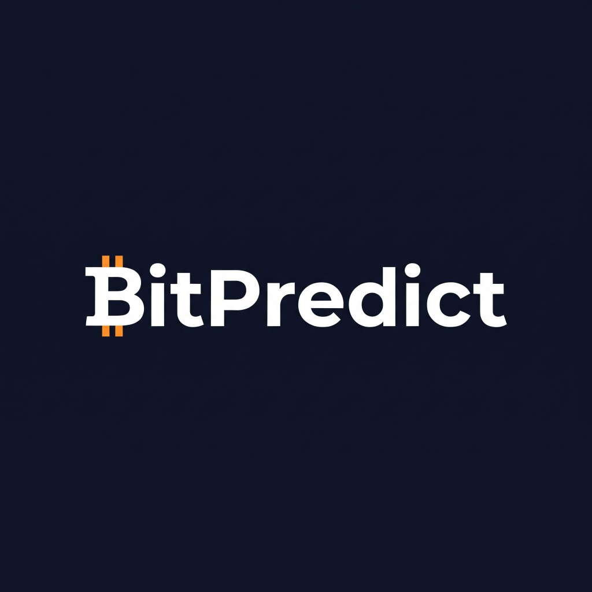

# 13 — Brand Identity

## 1. Name

**BitPredict**: written as one word with a capital **B** and a capital **P**. Never "Bitpredict", "Bit Predict", or "BITPREDICT" in body text.

- Tagline (suggested): *Predict anything. Settle in sats.*
- Descriptor: *Bitcoin AI Prediction Market*
- Repository folder: `dakar-BTC` (working name, unchanged)

## 2. Logo

| Asset | Path | Format |
| --- | --- | --- |
| Primary logo (wordmark on navy) | [`public/brand/bitpredict-logo.jpg`](../public/brand/bitpredict-logo.jpg) | JPG, 1024×1024 |

**Construction:** a heavy geometric sans wordmark in white. The **"B"** doubles as the Bitcoin symbol (₿), with two orange vertical strokes above and below the letter. The rest of the word ("itPredict") is plain white.

### Colors sampled from the logo

| Role | Hex | Notes |
| --- | --- | --- |
| Bitcoin Orange (₿ strokes) | `#F7931A` | Standard Bitcoin orange (sampled ≈ `#FC8F26`) |
| Wordmark White | `#FFFFFF` | Text |
| Logo Navy (background) | `#101529` | Square background of the JPG |

### Usage rules

- **Clear space:** keep at least the height of the "B" free on every side.
- **Minimum size:** 96 px wide (digital). Below that, use the "₿" monogram.
- **Backgrounds:** use it on dark backgrounds only (navy `#101529` or the UI canvas `#141415`). On light backgrounds you need an inverted variant (not produced yet).
- **Don't** recolor the ₿ strokes, stretch, rotate, add shadows/gradients, or set the wordmark in another font.

## 3. Relation to the UI Design System (`DESIGN.md`)

The UI tokens in [`DESIGN.md`](../DESIGN.md) use a green primary (`#00b24b`) and a blue secondary (`#0075ff`) on near-black. **Bitcoin Orange is a brand-mark color only.** Treat it like artwork (see the DESIGN.md gotcha on keeping artwork colors out of UI chrome). Don't use it for buttons, borders, or backgrounds.

> [!NOTE]
> Open decision: switch the UI primary to Bitcoin Orange to match the logo, or keep the logo orange and the UI green/blue apart. If orange becomes the primary, update `DESIGN.md` and regenerate the tokens with `design-sync.js build`.

## 4. Assets To Produce

- [ ] Transparent-background SVG wordmark (white) for the app header
- [ ] Inverted wordmark (navy/black) for light backgrounds
- [ ] "₿" monogram: favicon (32/16 px), app icon (512 px), Nostr profile picture
- [ ] Open Graph image (1200×630) for market share links
